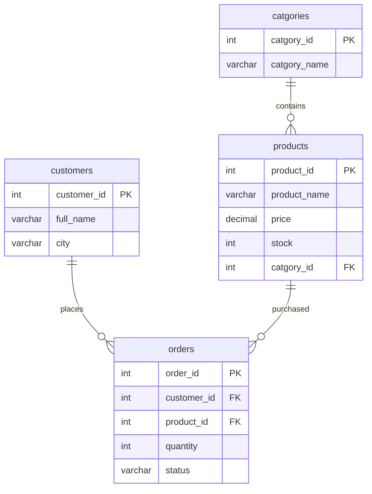

# ⚡ Intermediate MySQL Analytics: Relational JOINs, GROUP BY & HAVING Clauses

[](https://www.mysql.com/)
[]()
[]()
[](https://islamyasser424-design.github.io/portfolio-/)

> **A practical intermediate SQL assessment applying relational table joins, categorical multi-row grouping, inventory capacity auditing, and conditional post-aggregation filters (`HAVING`) on transactional e-commerce data.**

---

## 📌 Table of Contents
- [✨ Business Problem & Context](#-business-problem--context)
- [📐 Relational Architecture Refresher](#-relational-architecture-refresher)
- [🔍 Assessment Solutions & Query Walkthrough](#-assessment-solutions--query-walkthrough)
  - [Q1: Prefix Name Search (`LIKE 'A%'`)](#q1-prefix-name-search-like-a)
  - [Q2: Category Filter via Relational INNER JOIN](#q2-category-filter-via-relational-inner-join)
  - [Q3: Fulfillment Pipeline Volume by Order Status](#q3-fulfillment-pipeline-volume-by-order-status)
  - [Q4: Multi-Table Inventory Valuation (`SUM(stock)`)](#q4-multi-table-inventory-valuation-sumstock)
  - [Q5: High-Volume Customer Identification (`HAVING SUM > 2`)](#q5-high-volume-customer-identification-having-sum--2)
- [💡 Technical Insights: WHERE vs. HAVING](#-technical-insights-where-vs-having)
- [🚀 Execution Guide](#-execution-guide)
- [👤 Author & Connect](#-author--connect)

---

## ✨ Business Problem & Context

Operations management in modern retail relies on dynamic SQL queries to convert raw database records into strategic decisions:
* **Fulfillment Pipeline Monitoring:** Aggregating transactions by fulfillment status (`pending`, `shipped`, `delivered`) to expose logistics bottlenecks.
* **Warehouse Stock Auditing:** Joining catalog and inventory tables to identify low-stock categories before stock-out events occur.
* **Customer Value Segmentation:** Isolating high-volume purchasers exceeding historical volume thresholds via `HAVING` filters.

---

## 📐 Relational Architecture Refresher



---

## 🔍 Assessment Solutions & Query Walkthrough

### Q1: Prefix Name Search (`LIKE 'A%'`)
**Objective:** Display all customer profiles whose full name begins with `'A'`.
```sql
SELECT 
    customer_id,
    full_name,
    email,
    city,
    joined_at
FROM customers
WHERE full_name LIKE 'A%'
ORDER BY full_name ASC;
```
#### Output:
| customer_id | full_name | email | city | joined_at |
|:---:|:---|:---|:---|:---:|
| **1** | Ahmed Ali | ahmed@mail.com | Cairo | 2023-01-15 |

---

### Q2: Category Filter via Relational INNER JOIN
**Objective:** Display all active products belonging to the **Electronics** category.
```sql
SELECT 
    p.product_id,
    p.product_name,
    p.price,
    p.stock,
    cat.catgory_name AS category_name
FROM products p
INNER JOIN catgories cat 
    ON p.catgory_id = cat.catgory_id
WHERE cat.catgory_name = 'Electronics'
ORDER BY p.price DESC;
```
#### Output:
| product_id | product_name | price | stock | category_name |
|:---:|:---|:---:|:---:|:---|
| **1** | Laptop Pro | 15000.00 | 10 | Electronics |
| **2** | Wireless Mouse | 350.00 | 50 | Electronics |

---

### Q3: Fulfillment Pipeline Volume by Order Status
**Objective:** Calculate the total volume of orders segmented by fulfillment status.
```sql
SELECT 
    status,
    COUNT(order_id) AS total_orders
FROM orders
GROUP BY status
ORDER BY total_orders DESC;
```
#### Output:
| status | total_orders |
|:---|:---:|
| **delivered** | 4 |
| **shipped** | 2 |
| **pending** | 2 |

---

### Q4: Multi-Table Inventory Valuation (`SUM(stock)`)
**Objective:** Audit total on-hand warehouse units available across each product category.
```sql
SELECT 
    cat.catgory_id,
    cat.catgory_name AS category_name,
    SUM(p.stock) AS total_available_stock
FROM products p
INNER JOIN catgories cat 
    ON p.catgory_id = cat.catgory_id
GROUP BY cat.catgory_id, cat.catgory_name
ORDER BY total_available_stock DESC;
```
#### Output:
| catgory_id | category_name | total_available_stock |
|:---:|:---|:---:|
| **2** | Clothing | 140 |
| **1** | Electronics | 60 |
| **4** | Home & Garden | 30 |
| **3** | Books | 25 |

---

### Q5: High-Volume Customer Identification (`HAVING SUM > 2`)
**Objective:** Identify customers whose cumulative order quantities exceed 2 units.
```sql
SELECT 
    c.customer_id,
    c.full_name,
    c.city,
    SUM(o.quantity) AS total_items_purchased
FROM customers c
INNER JOIN orders o 
    ON c.customer_id = o.customer_id
GROUP BY c.customer_id, c.full_name, c.city
HAVING SUM(o.quantity) > 2
ORDER BY total_items_purchased DESC;
```
#### Output:
| customer_id | full_name | city | total_items_purchased |
|:---:|:---|:---|:---:|
| **1** | Ahmed Ali | Cairo | 4 |
| **2** | Sara Hassan | Alexandria | 4 |

---

## 💡 Technical Insights: WHERE vs. HAVING

```
┌─────────────────────────────────────────────────────────────┐
│                       SQL EXECUTION ORDER                   │
├─────────────────────────────────────────────────────────────┤
│ 1. FROM & JOIN     ──> Locates base tables & links FKs      │
│ 2. WHERE           ──> Filters individual raw rows          │
│ 3. GROUP BY        ──> Collapses rows into summary groups   │
│ 4. AGGREGATES      ──> Computes SUM, COUNT, AVG per group   │
│ 5. HAVING          ──> Filters groups based on aggregates   │
│ 6. SELECT          ──> Emits requested column projections   │
│ 7. ORDER BY        ──> Sorts resulting output dataset       │
└─────────────────────────────────────────────────────────────┘
```

* **`WHERE`:** Evaluated **before** grouping; cannot reference aggregate expressions like `SUM(quantity)`.
* **`HAVING`:** Evaluated **after** aggregation; essential for filtering aggregated metrics (`HAVING SUM(quantity) > 2`).

---

## 🚀 Execution Guide

```bash
# Clone the repository
git clone https://github.com/islamyasser424-design/SQL-Quiz-2.git
cd SQL-Quiz-2

# Run queries against active online_store database
mysql -u root -p online_store < SQL_Quiz_02_Intermediate_Joins_Aggregations.sql
```

---

## 👤 Author & Connect

* **Author:** Islam Yasser — *Data Analyst & Business Intelligence Specialist*
* **Portfolio:** [islamyasser424-design.github.io/portfolio-/](https://islamyasser424-design.github.io/portfolio-/)
* **LinkedIn:** [linkedin.com/in/islam-yasser-55048b378](https://www.linkedin.com/in/islam-yasser-55048b378/)
* **GitHub:** [github.com/islamyasser424-design](https://github.com/islamyasser424-design)